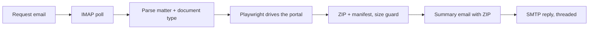
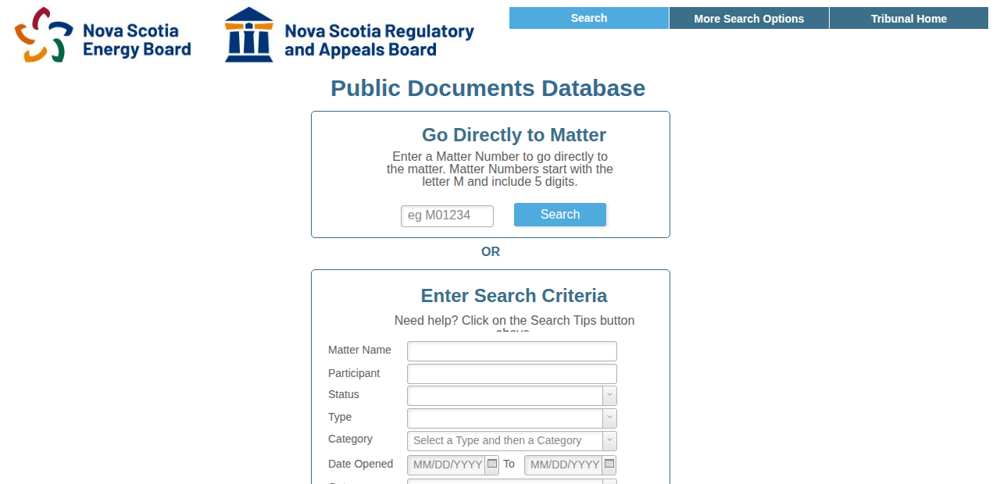
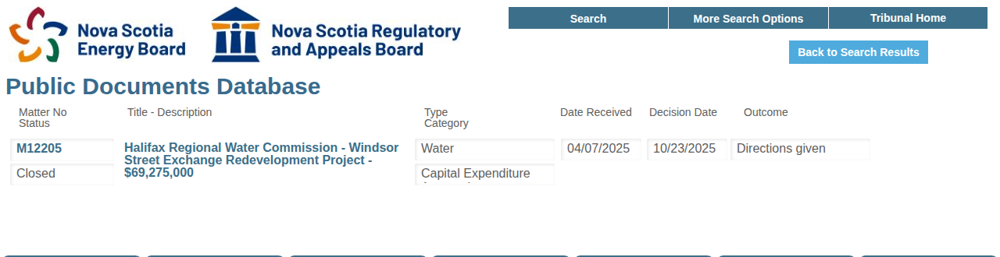
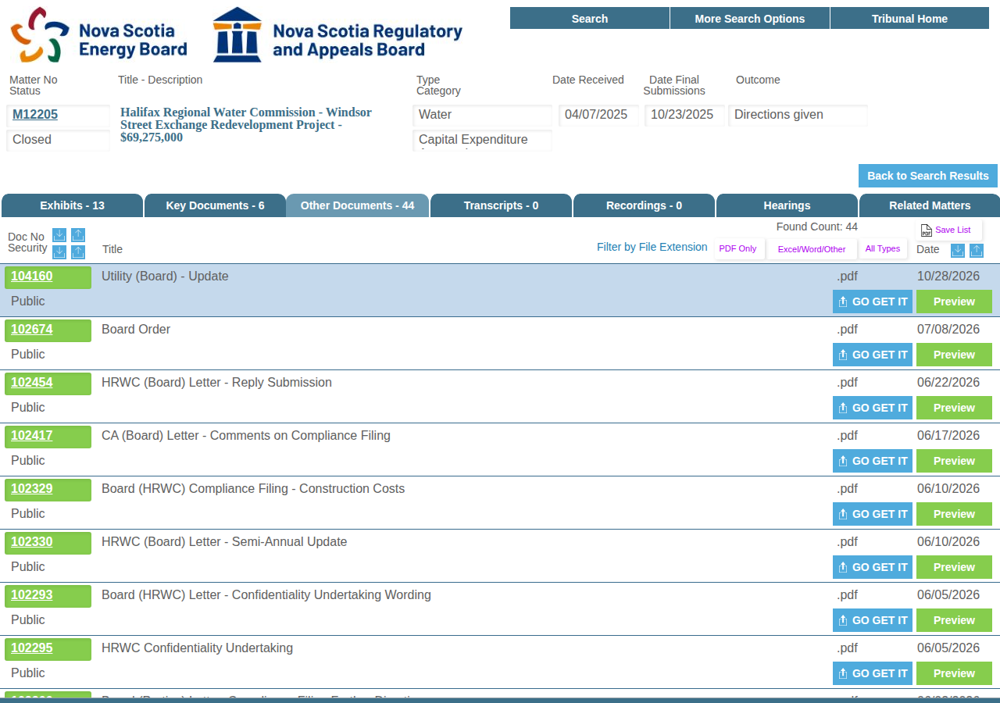
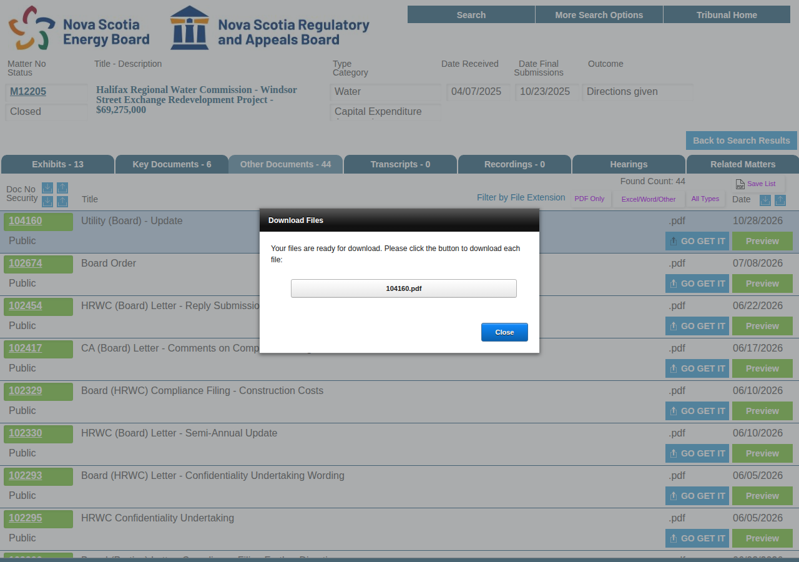

# UARB Regulatory Agent

[](https://github.com/AbhyudayaSikri/uarb-regulatory-agent/actions/workflows/ci.yml)
[](LICENSE)

An email-driven agent that fetches regulatory filings from the
[Nova Scotia Utility and Review Board public documents portal](https://uarb.novascotia.ca/fmi/webd/UARB15),
zips up to 10 of them, and replies with the ZIP plus a summary of the matter.

You email it:

> Hi Agent, can you give me Other Documents files from M12205? Thanks!

It replies (real output, 22 seconds end to end):

> Hi User,
>
> M12205 is about the Halifax Regional Water Commission - Windsor Street Exchange Redevelopment
> Project - $69,275,000. It relates to Capital Expenditure Approvals within the Water category.
> The matter is Closed with outcome "Directions given". It had an initial filing on April 7, 2025
> and a final filing on October 23, 2025.
>
> I found 13 Exhibits, 6 Key Documents, 44 Other Documents, and no Transcripts or Recordings
> (63 files in total).
>
> I downloaded 10 out of the 44 Other Documents and am attaching them as a ZIP here
> (M12205-other-documents.zip).
>
> Attached files:
> - 104160: Utility (Board) - Update (2026-10-28) - 104160.pdf
> - 102674: Board Order (2026-07-08) - 102674.pdf
> - ...
>
> Regards,
> UARB Regulatory Agent

The ZIP contains the original PDFs plus a `MANIFEST.csv` (document number, title, date,
security, file name, size).

## How it works



The portal is a FileMaker WebDirect application with no API, so the agent does exactly what a
person would do, in a headless Chromium:

| Step | What the agent does | Screenshot |
|---|---|---|
| 1 | Opens the portal and types the matter number into **Go Directly to Matter**, presses Enter |  |
| 2 | Reads the header (title, type, category, status, dates, outcome) and the counts in the tab captions |  |
| 3 | Opens the requested tab and walks the rows top to bottom |  |
| 4 | Presses **GO GET IT**, saves the file offered by the *Download Files* dialog, closes it; repeats up to 10 times |  |

Details, selectors and edge cases are in [docs/architecture.md](docs/architecture.md).

## Quick start

You need a mailbox the agent can own (IMAP + SMTP). A dedicated Gmail account with 2-step
verification and an [App Password](https://support.google.com/accounts/answer/185833) works.

### Option A: Docker (recommended, always on)

```bash
git clone https://github.com/AbhyudayaSikri/uarb-regulatory-agent.git
cd uarb-regulatory-agent
cp .env.example .env      # fill in IMAP_* and SMTP_*
docker compose up -d
docker compose logs -f
```

Now email the mailbox a request. The agent polls every `POLL_INTERVAL_SECONDS` (default 60).

### Option B: GitHub Actions (no server at all)

1. Fork this repository.
2. Settings > Secrets and variables > Actions > **Secrets**: add `IMAP_USER`, `IMAP_PASSWORD`,
   `SMTP_USER`, `SMTP_PASSWORD`, `SMTP_FROM`.
3. Optional **Variables**: `IMAP_HOST`/`SMTP_HOST` (default Gmail), `ALLOWED_SENDERS`,
   `MAX_DOCUMENTS`, `MAX_ATTACHMENT_MB`.
4. Enable workflows in the Actions tab. `Agent` then polls the mailbox every 10 minutes. You can
   also open the workflow and press **Run workflow** with a matter number, type and recipient to
   answer one request immediately.

GitHub schedules are best effort (expect 5 to 15 minutes of latency) and are paused after
60 days without repository activity, so use Docker if you need low latency.

### Option C: local Python

```bash
python -m venv .venv && source .venv/bin/activate
pip install -e ".[dev]"
playwright install --with-deps chromium     # or set BROWSER_CHANNEL=chrome to use installed Chrome
cp .env.example .env

# Try it without any mailbox: fetch, zip and write the reply to ./out as an .eml
uarb-agent run --matter M12205 --type "Other Documents" --dry-run

# Send one reply by email
uarb-agent run --matter M12205 --type "Other Documents" --to you@example.com

# Process the mailbox once (cron) or forever
uarb-agent poll-once
uarb-agent serve
```

`uarb-agent check-config` prints the effective configuration.

## Configuration

Everything is an environment variable (or a line in `.env`). See [.env.example](.env.example).

| Variable | Default | Meaning |
|---|---|---|
| `IMAP_HOST`, `IMAP_PORT`, `IMAP_USER`, `IMAP_PASSWORD`, `IMAP_FOLDER` | `imap.gmail.com`, `993`, , , `INBOX` | Where requests arrive. Unread messages are processed and marked read. |
| `SMTP_HOST`, `SMTP_PORT`, `SMTP_USER`, `SMTP_PASSWORD`, `SMTP_FROM`, `SMTP_USE_SSL` | `smtp.gmail.com`, `587`, , , , `false` | How replies are sent. STARTTLS on 587, implicit TLS on 465. |
| `MAX_DOCUMENTS` | `10` | Maximum files per request. |
| `MAX_ATTACHMENT_MB` | `20` | ZIP size cap (Gmail allows 25 MB). The largest files are dropped until it fits and the email says which. |
| `ALLOWED_SENDERS` | *(anyone)* | Comma separated addresses or `@domains` allowed to use the agent. |
| `RATE_LIMIT_PER_SENDER_PER_HOUR` | `6` | Per-sender throttle (per process). |
| `POLL_INTERVAL_SECONDS` | `60` | `serve` mode polling interval. |
| `HEADLESS`, `BROWSER_CHANNEL` | `true`, `chromium` | Browser settings. `chrome` or `msedge` use an installed browser. |
| `WORK_DIR` | `./out` | Downloads, ZIPs and dry-run `.eml` files. Cleaned after a successful send. |
| `LLM_PROVIDER` | `none` | `openai` or `anthropic` enable free-form request parsing and a friendlier reply. Needs `OPENAI_API_KEY` / `ANTHROPIC_API_KEY` and `pip install ".[openai]"` or `".[anthropic]"`. |

The LLM is optional by design: parsing is deterministic (`M\d{5}` plus the five document type
names and common variants) and the reply is templated from scraped facts. When an LLM is enabled
it is only consulted when the deterministic parser fails, and its rewritten reply is discarded
unless every number, date, matter id and file name survives verbatim.

## What the agent handles

- All five tabs: Exhibits, Key Documents, Other Documents, Transcripts, Recordings.
- Matters that do not exist (`No Records Found` dialog) get a polite "not found" reply.
- Empty tabs (`No Matching Records` dialog) are reported with zero downloads.
- Confidential rows cannot be downloaded from the public portal; they are skipped and counted
  in the reply. Failed downloads are skipped the same way.
- Attachment size: files that exceed the cap are dropped and named in the reply.
- Auto-replies, bounces and mailing-list traffic are ignored (no loops). Replies carry
  `Auto-Submitted: auto-replied`.
- Transient portal errors (session expired, communication problem) trigger one full retry in a
  fresh browser session; a failure screenshot is saved under `WORK_DIR`.

## Development

```bash
pip install -e ".[dev]"
ruff check .
pytest                         # unit tests, no network
UARB_LIVE=1 pytest tests/live  # real portal, downloads two files
```

Layout:

```
src/uarb_agent/
  cli.py          typer commands: run, poll-once, serve, check-config
  agent.py        orchestration, allow-list, rate limit, retries
  intent.py       deterministic request parser
  llm.py          optional OpenAI/Anthropic helpers
  scraper/        Playwright driver (uarb.py), selectors.py, fake.py
  zipper.py       ZIP + MANIFEST.csv + size guard
  summary.py      reply composer (text + HTML)
  mail/           IMAP inbox, SMTP outbox, RFC 822 parsing, fakes
tests/            unit tests (fakes) and opt-in live tests
docs/             architecture notes, screenshots, chat history
```

## Limitations

- The portal has no API and no deep links; every request starts a fresh WebDirect session and
  takes 15 to 30 seconds plus download time.
- Selectors depend on the portal's current layout. They are text and structure based (no
  generated ids) but a redesign would require updating `scraper/selectors.py`.
- "Up to 10 documents" means the first 10 rows in the tab's default order (newest first on the
  Other Documents tab). There is no filtering by date or keyword yet.
- Very large exhibits (some are 25 to 50 MB) cannot be emailed; the reply says which ones were
  left out.

## Project history

This repository was built by a Cursor cloud agent working with its owner from a technical
assignment brief. The conversation is recorded step by step in
[docs/chat-history](docs/chat-history/), and the commit history mirrors the milestones.

## License

[MIT](LICENSE)
