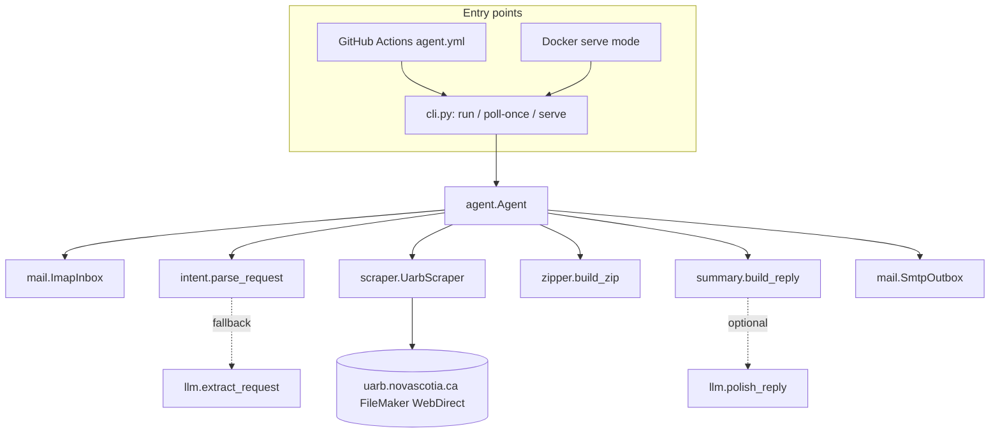

# Architecture

## Components

Each layer talks to the next through plain dataclasses in `models.py` (`MatterRequest`,
`MatterMetadata`, `TabCounts`, `DocumentRow`, `DownloadedFile`, `ScrapeResult`, `ZipResult`,
`OutboundMessage`). The scraper, inbox and outbox each have an in-memory fake so the whole
pipeline is unit-tested without network access.

## Request lifecycle

1. `ImapInbox.fetch_unprocessed` searches `UNSEEN`, fetches with `BODY.PEEK[]` (which does not
   set `\Seen`), parses each message (`mail/parsing.py`) and flags auto-replies, bounces and
   list mail. Messages are only marked `\Seen` after handling, so a crash leaves them for the
   next poll.
2. `Agent.handle` drops automatic mail, enforces `ALLOWED_SENDERS` and the per-sender rate
   limit, then parses the request. Parsing failures get the help text; if an LLM is configured
   it gets one chance to extract the request before that.
3. `UarbScraper.fetch` drives the portal (below) and returns metadata, tab counts, downloaded
   files and skipped rows.
4. `zipper.build_zip` writes `<matter>-<type>.zip` with a `MANIFEST.csv`, dropping the largest
   files until the archive is under `MAX_ATTACHMENT_MB`.
5. `summary.build_reply` composes the text and HTML bodies in the style of the assignment's
   example. If an LLM is configured, `polish_reply` may rewrite the text, but the rewrite is
   discarded unless every number, date, matter id and file name is preserved.
6. `SmtpOutbox.send` sends a threaded reply (`In-Reply-To`/`References`) with the ZIP attached
   and `Auto-Submitted: auto-replied` so other robots do not answer it. Sending is retried
   three times; the work directory is removed after a successful send.

## Portal automation

The portal is FileMaker WebDirect (Vaadin 8). Everything is rendered client side, there are no
deep links, state lives in a server session, and element ids are generated
(`b0p1o299i3i0r1` = part 1, layout object 299, row 3). Selectors therefore rely on structure
and visible text. Verified 2026-10-28:

| Need | How |
|---|---|
| Landing loaded | text `Go Directly to Matter` |
| Matter input | `div.placeholder` containing `eg M01234`, sibling `div.text`; becomes `contenteditable` once clicked; type + Enter |
| Matter missing | `.v-window` dialog titled `No Records Found`, click `OK`, raise `MatterNotFoundError` |
| Header fields | read-only fields `.fm-textarea.v-readonly .inner_border > .text` and text blocks `.v-label.text`; a block whose lines are all known labels (`Matter No`/`Status`, `Title - Description`, `Type`/`Category`, `Date Received`, `Decision Date` or `Date Final Submissions`, `Outcome`) is a label; each value is matched to the nearest label above it that overlaps horizontally |
| Tab counts | `span.fm-text-character` matching `^(Exhibits|Key Documents|Other Documents|Transcripts|Recordings) - \d+$` |
| Open tab | click the span; wait for `.iwps_button_bar_segment.fm-selected` with the same text; a `No Matching Records` dialog means empty |
| Rows | `tr.v-grid-row-has-data`, sorted by bounding-box `y`; `innerText` lines give doc/exhibit number, title, date, security, file type |
| Virtualized grid | a 2400px tall viewport renders about 33 rows; `.v-grid-scroller-vertical` is scrolled when more are needed and rows are de-duplicated by (doc no, title, date) |
| Download | click `button:has-text('GO GET IT')` inside the row, wait for the `.v-window` titled `Download Files`, click each `.v-button.fm-download-button` inside `page.expect_download()`, save with the server's filename, click `Close` |
| Session trouble | body text containing `Communication problem` / `Session Expired` raises `PortalError`; `fetch` retries once with a brand-new browser context and saves `failure-<matter>-attempt<n>-<ts>.png` |

Observed facts worth knowing:

- Download URLs look like `/fmi/webd/APP/connector/0/<n>/dl/<docno>.pdf` with
  `Content-Disposition: attachment`. The filename is the document number.
- The Other Documents tab lists newest first. Exhibits list by exhibit number.
- Rows marked `Confidential` are listed but not downloadable publicly; the agent skips them.
- Some document numbers point at the same PDF (for M12205, 102329 and 102330 are byte
  identical on the portal itself).
- The overview layout labels the second date `Decision Date`; the list layouts label it
  `Date Final Submissions`. Both map to `date_final_submissions`, reported as the "final
  filing" date.

## Deployment options

| Option | Latency | Needs | Notes |
|---|---|---|---|
| `docker compose up -d` | `POLL_INTERVAL_SECONDS` (60 s) | any Docker host | Official Playwright image, non-root, persistent `/data` volume |
| GitHub Actions `agent.yml` | 10 min cron, best effort | nothing | Secrets in the repo, concurrency group prevents overlapping pollers, `workflow_dispatch` answers one request on demand |
| `uarb-agent serve` | 60 s | Python 3.11+, Chromium | For a VM or laptop |

## Testing

- `pytest`: 50 unit tests with fakes (parsing, geometry matching from recorded page boxes,
  row parsing, zip size guard, reply wording, agent flow, SMTP against a local `aiosmtpd`
  server, IMAP against a protocol stub).
- `UARB_LIVE=1 pytest tests/live`: real portal, matter M12205, downloads two files, checks the
  not-found and empty-tab paths.
- `uarb-agent run ... --dry-run`: full pipeline without sending; writes the `.eml` and ZIP.
- CI runs lint, unit tests and a Docker build with a fake dry run on every push; live tests
  can be triggered manually.
